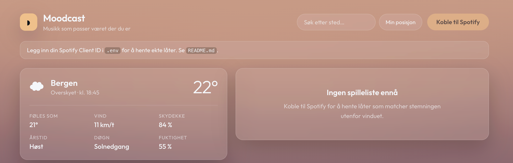
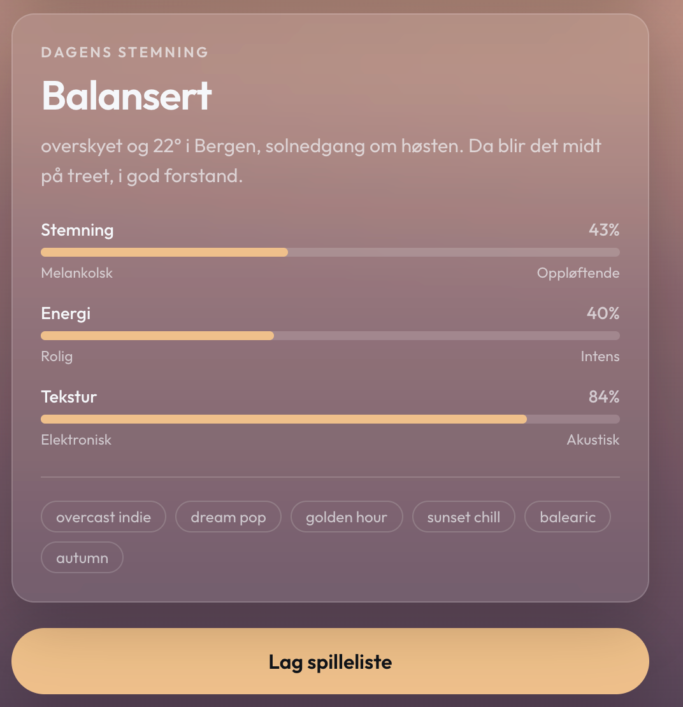

# Moodcast

Musikk som passer været der du er. Moodcast henter været fra Open-Meteo, regner ut
en stemning basert på **vær + årstid + tid på døgnet**, og bygger en Spotify-spilleliste
som matcher. Bakgrunnen endrer farger og animasjon etter været.

## Kom i gang

### 1. Installer avhengigheter

```bash
npm install
```

### 2. Lag en Spotify-app

> **Viktig:** Siden februar 2026 krever Spotify at den som eier appen har
> **Spotify Premium**. Én person i gruppa lager appen, og de andre legges til
> som brukere (maks 5 totalt). Se «Development Mode» nedenfor.

1. Gå til [developer.spotify.com/dashboard](https://developer.spotify.com/dashboard) og logg inn.
2. Trykk **Create app**.
   - **App name:** Moodcast
   - **App description:** Spilleliste basert på vær, årstid og tid på døgnet
   - **Redirect URI:** `http://127.0.0.1:5173/callback` → trykk **Add**
   - **Which API/SDKs are you planning to use:** kryss av **Web API**
   - Godta vilkårene og trykk **Save**
3. Åpne appen → **Settings** → kopier **Client ID**.

> Bruk `127.0.0.1` og ikke `localhost`. Spotify sluttet å godta `localhost` som redirect URI i 2025.

### 3. Legg inn Client ID

```bash
cp .env.example .env
```

Lim inn Client ID i `.env`:

```
VITE_SPOTIFY_CLIENT_ID=din_client_id_her
```

### 4. Start appen

```bash
npm run dev
```

Åpne **http://127.0.0.1:5173** (ikke `localhost`, ellers matcher ikke redirect URI-en).

### 5. Legg til brukere (Development Mode)

Nye Spotify-apper starter i **Development Mode**, der kun brukere som er lagt inn
manuelt kan logge på. I dashboardet: **Settings → User Management** → legg inn
navn og e-postadressen til Spotify-kontoen til hver i gruppa.

Reglene som gjelder fra februar 2026:

| Krav                     | Grense                                |
| ------------------------ | ------------------------------------- |
| Premium hos app-eieren   | Påkrevd — appen slutter å virke uten  |
| Client ID per utvikler   | 1                                     |
| Brukere per app          | 5                                     |

Hvis noen i gruppa får «INVALID_CLIENT» eller blir avvist ved innlogging, er det
nesten alltid fordi e-postadressen deres ikke er lagt inn her, eller at den ikke
er *helt* identisk med e-posten på Spotify-kontoen deres.

## Hvordan stemningen regnes ut

Tre faktorer gir hver sin justering av tre akser:

| Akse             | 0                | 1            |
| ---------------- | ---------------- | ------------ |
| `valence`        | melankolsk       | oppløftende  |
| `energy`         | rolig            | intens       |
| `acousticness`   | elektronisk      | akustisk     |

- **Været** (`src/lib/mood.ts` → `WEATHER_NUDGE`) — torden gir høy energi, snø gir akustisk ro.
- **Årstiden** (`SEASON_NUDGE`) — sommer løfter, høst demper.
- **Tid på døgnet** (`DAYPART_NUDGE`) — morgen er mykt, ettermiddag har driv.

I tillegg justerer temperatur, vindstyrke og skydekke resultatet. Aksene oversettes
til søkeord som sendes til Spotifys søke-API.

## Om Spotify-API-et

Spotify har strammet inn i to runder, og Moodcast er tilpasset begge:

**November 2024** — `/recommendations`, `/audio-features` og `/related-artists` ble
fjernet for nye apper. Derfor bygger vi spillelisten av søketreff i stedet for å
la Spotify anbefale låter ut fra tallverdier.

**Februar 2026** — flere endepunkter og felt forsvant for Development Mode-apper.
Moodcast bruker bare det som fortsatt er tilgjengelig:

| Endepunkt                      | Brukes til                              |
| ------------------------------ | --------------------------------------- |
| `GET /search`                  | Henter låter ut fra stemningens søkeord |
| `GET /me`                      | Brukernavn og profilbilde               |
| `GET /me/top/tracks`           | Blander inn noen egne favoritter        |
| `POST /me/playlists`           | Oppretter spillelisten                  |
| `POST /playlists/{id}/items`   | Fyller den med låter                    |

Endringer som påvirket koden vår:

- `POST /users/{id}/playlists` → erstattet med `POST /me/playlists`
- `POST /playlists/{id}/tracks` → erstattet med `POST /playlists/{id}/items`
- `popularity` på låter ble fjernet → vi rangerer etter søkerelevans i stedet
- `product` og `email` på brukeren ble fjernet → scopet `user-read-email` er droppet

Innlogging skjer med **PKCE**, så ingen client secret trengs og alt kjører i nettleseren.

## Struktur

```
src/
├── App.tsx                     Hovedvisning og tilstand
├── styles.css                  All styling, drevet av CSS-variabler
├── lib/
│   ├── weather.ts              Open-Meteo: stedssøk og værdata
│   ├── mood.ts                 Vær + årstid + døgn → stemning
│   ├── theme.ts                Stemning → farger og partikkeleffekt
│   ├── spotifyAuth.ts          PKCE-innlogging og token-fornyelse
│   └── spotify.ts              Søk, spillelistebygging og lagring
└── components/
    ├── WeatherCanvas.tsx       Regn, snø, stjerner, tåke, lyn
    ├── PlaceSearch.tsx         Søkefelt med autofullfør
    ├── WeatherPanel.tsx        Dagens værforhold
    ├── MoodPanel.tsx           Stemningsakser og søkeord
    └── PlaylistPanel.tsx       Låteliste med smakebiter
```



Her er sånn nettsiden foreløpig ser ut!

## Bygg for produksjon

```bash
npm run build
npm run preview
```

Legg til produksjons-URL-en som redirect URI i Spotify-dashboardet, f.eks.
`https://moodcast.vercel.app/callback`.

## Kreditering

Værdata fra [Open-Meteo](https://open-meteo.com) (gratis, ingen nøkkel).
Reverse geocoding fra [BigDataCloud](https://www.bigdatacloud.com).
Musikkdata fra [Spotify Web API](https://developer.spotify.com/documentation/web-api).
